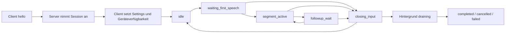

# Zielbild des Windows-Desktop-Clients V2

## Produktverhalten

Ein dauerhaft laufender Client überträgt Mikrofon-Audio an eine `/ws/v2`-Session. Der Server entscheidet über Activations, Sprachsegmente, VAD, Fristen und finale Ergebnisse. Manual und Wake Word sind zwei Quellen desselben Lifecycles. Es gibt keine auswählbaren Betriebsmodi „Hotkey-Diktat“ und „Wake-Word-Diktat“.

Die Basiskonfiguration enthält `manual`, `wakeWord` oder beide; mindestens eine Quelle muss eingeschaltet sein. Wake Word benötigt mindestens eine gültige kanonische Modell-ID. Eine Laufzeitpause unterdrückt Manual und Wake Word getrennt, darf beide effektiv abschalten und übersteht Reconnects innerhalb desselben Programmstarts. Nach Programmneustart gelten wieder die gespeicherten Quellen ohne die vorherige Laufzeitpause. Es gibt keine zusätzliche „alle Trigger pausieren“-Aktion.

Audio läuft nach Sessionkonfiguration durchgehend, auch in `idle` und während älterer Hintergrundfinalisierungen. Der Client stoppt Audio nicht wegen `finish`, `cancel`, VAD-Ende oder Wake-Pause. Physisches Mute, Audiogeräteverlust und Shutdown sind eigene lokale Zustände. Der Client führt kein lokales VAD oder Wake-Modell ein.

## Autoritäten

| Sachverhalt | Autorität | Clientverantwortung |
| --- | --- | --- |
| Session-, Activation-, Segmentidentitäten | Server | unverändert übernehmen, niemals aus dem aktuellen Vordergrund erraten |
| Vordergrundphase, Aufnahmebeginn/-ende, Timings | Server | Events/Snapshots spiegeln; Countdown nur anzeigen |
| Manual-Interaktion | Benutzer / Client | gültiges Command erzeugen und quittieren lassen |
| Wake-Erkennung | Server | kontinuierliches Audio; Ereignis anzeigen |
| gewünschte lokale Basiskonfiguration | Client | validiert speichern und nach Reconnect erneut anwenden |
| wirksame Sessionwerte | Server | requested/effective auseinanderhalten |
| globale Einstellungen und Defaults | Server mit Admin-Guard | Revision prüfen, Antwort anzeigen, sicheren Credential-Speicher anbieten |
| Audiogerät, ReSpeaker, Hotkeys, Clipboard | Client / Windows | Verfügbarkeit, Fehler und Wiederanbindung verwalten |
| Darstellung und Feedback | Client | quellenneutral aus dem V2-Spiegel ableiten |
| Loghistory | separater Serverlogvertrag | Diagnose; keine zweite Lifecycle-Autorität |

## Zustandsmodell

`idle` und Hintergrund-`draining` können gleichzeitig bestehen. Ein älteres Final darf zu jedem Zeitpunkt eintreffen, ohne die neuere Vordergrundphase zurückzusetzen. Ein Activation-Terminal kann vor `activation.input_closed` kommen; eine neue Activation kann vor dem `input_closed` der alten sichtbar werden. Der Client behandelt diese Ereignisse über ihre IDs unabhängig.

## Bedienvertrag

- Primärer Activation-Hotkey: in `idle` manuell aktivieren, wenn die Quelle effektiv verfügbar ist. In einer offenen Activation die konfigurierte Aktion `refresh`, `finish`, `cancel` oder `none` ausführen.
- Zweiter Activation-Control-Hotkey: in `idle` keine Aktion; bei offener Activation seine separat konfigurierte Active-Aktion ausführen.
- Optionaler dritter Hotkey: ausschließlich Wake-Pause toggeln. Die laufende Activation wird dabei nicht beendet.
- Control-Hotkeys sind auch bei Wake-only und pausiertem Manual verfügbar. Wiederholungen und kollidierende Belegungen erzeugen keine doppelten Commands.
- `refresh` ist vor dem ersten Sprechen wirkungslos (`invalid_phase` bei trotzdem gesendetem Command). Im Follow-up setzt es die Serverfrist neu; während einer Aufnahme sichert es die serverkonfigurierte Mindestrestzeit des Watchdogs. Es gibt kein kumulatives `extend`.
- `finish` schließt die Eingabe und verarbeitet erfasstes Audio. `cancel` verwirft noch unveröffentlichte Ergebnisse der adressierbaren offenen Activation. Vorher eingefügter Text bleibt erhalten.

Diese Planung legt für neue Profile `primary.activeAction=refresh`, `secondary.activeAction=finish`, `secondary.key` leer und `wakePause.key` leer fest. Bestehende explizite Finish-/Cancel-Belegungen werden verlustfrei migriert. Falls zwei bestehende Controls nicht in zwei Slots passen, zeigt der Migrationsdialog den Konflikt; er löscht keine Belegung stillschweigend. Zusätzliche dedizierte UI-Buttons für Finish/Cancel bleiben verfügbar. Die Defaults sind Cliententscheidungen, keine Serverfelder.

## Texte und Nebenwirkungen

`transcription.interim` ist ausschließlich ersetzbare Vorschau des eigenen Segments. Auch als stabil bezeichnete Interimteile werden nicht in andere Programme eingefügt. Nur `transcription.completed` darf die Final-Pipeline auslösen. `discarded`, `failed`, leere Ergebnisse und wiederholte Terminals lösen keine Textinjektion aus.

Historie und automatische Injektion sind über `(sessionId, segmentId)` dedupliziert; `activationId` und `segmentSequence` bleiben für Zuordnung und Reihenfolge erhalten. Ein Prozessabsturz zwischen `SendInput` und lokaler Statusspeicherung kann externen Erfolg nicht beweisen. Deshalb wird ein unklarer Injectionversuch als „Status unbekannt“ angezeigt und nie automatisch wiederholt. Manuelles Wiedereinfügen bleibt eine bewusste Benutzeraktion.

## Feedback und Fehler

Tray, In-App-Anzeige, Overlay, Sound und LED teilen denselben fachlichen Zustand für Manual und Wake Word. Eingabeschluss räumt den Aufnahmeslot; eine zusätzliche Hintergrundanzeige darf ausstehende Ergebnisse zeigen. Ein älteres `completed`-Event darf einen aktuell aufnehmenden LED-/UI-Zustand nicht überschreiben. Quelle, IDs und technische Gründe dürfen in der Diagnose erscheinen.

Verbindungsverlust invalidiert alte Commands und nicht veröffentlichte Ergebnisse. Audiogeräteverlust meldet `audioAvailable=false`, cancelt die offene Activation, erhält Session und ältere Hintergrundjobs und startet lokale Gerätewiederanbindung. Ein reiner LED-Verlust meldet LED-Degradation und wird unabhängig vom Mikrofon behandelt.

Eine Eventlücke löst Resync aus. Der Snapshot kann Phase und Zähler rekonstruieren, aber keine verlorenen Texte. Bereits empfangene und gepufferte Texte bleiben erhalten; fehlende Ausgaben werden sichtbar als unvollständig markiert. Der Logstream repariert die Domainausgabe nicht automatisch.

## Einstellungen und technischer Rahmen

Python 3.12, PySide6, Qt-Main-Thread, asyncio-Core im eigenen Thread, native Win32-Hotkeys, Clipboard/SendInput, SQLite-Historie und bestehende LED-Schnittstelle bleiben bestehen. Zielpaketnamensraum nach CV2-000 ist `voice_stt_client`; der heutige Featurestand hat noch Toplevel-core/ui. Interne Repräsentationen und UI-Anordnung folgen dem [Umsetzungsspielraum](../../SKILLS/GEMEINSAM/references/PLANUNGSSPIELRAUM.md).

Der Dialog trennt lokale Bedien-/Geräte-/Feedbackwerte, gewünschte Sessionwerte und adminpflichtige Serverdefaults. Er zeigt Apply-Policy, requested/effective, Revision und Kalibrierungsstatus. Die zwei Wake-Engine-Optionen mit `next_session` (`noiseSuppressionEnabled`, `vadThreshold`) können am festgelegten Servercommit nicht durch einen lokalen Sessionpatch plus Reconnect als individuelle Präferenz aktiviert werden: hierfür existiert nur der Serverdefaultpfad. Die UI behauptet keinen Erfolg dieses nicht vorhandenen Pfads.

Reconnectpflichtige Änderungen während offener Eingabe bieten ausdrücklich: sofort canceln und neu verbinden; Eingabe geordnet schließen und nach Eingabeschluss neu verbinden; bis zum manuellen Reconnect vormerken. Noch drainende Ergebnisse würden beim Reconnect verloren gehen: Die UI nennt die Zahl ausstehender Activations und verlangt eine bewusste Wahl zwischen Ergebnisverlust und Warten bis zum Drain. Keine Settingsänderung cancelt implizit Nutzerarbeit.

Der Arbeitsumfang endet mit integriertem Client, vollständiger Regression, qualifiziertem Build und realer Abnahme. Browserclient, zusätzliche STT-Engines, neue Feedbackhardware und eine umfassende weitere Administrationsoberfläche gehören nicht zu diesem Umbau.
